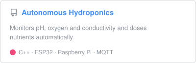

<h1>Hi, I'm Eden 🐼</h1>

I like building things end to end — from sensors and microcontrollers to web apps and the data in between.

---

### 🔧 Tech I work with

### 🚀 Selected projects

### 📚 Currently

- 🎓 Studying networks, databases, statistics and cryptography
- 🤖 Building my own productivity and learning tools with AI agents
- 🧪 Exploring EMG-based gesture recognition

---

<picture><source media="(prefers-color-scheme: dark)" srcset="https://raw.githubusercontent.com/EdenBernhard/EdenBernhard/output/github-snake-dark.svg" /><source media="(prefers-color-scheme: light)" srcset="https://raw.githubusercontent.com/EdenBernhard/EdenBernhard/output/github-snake.svg" /></picture>

Open to collaborating on student projects — feel free to reach out via GitHub.
